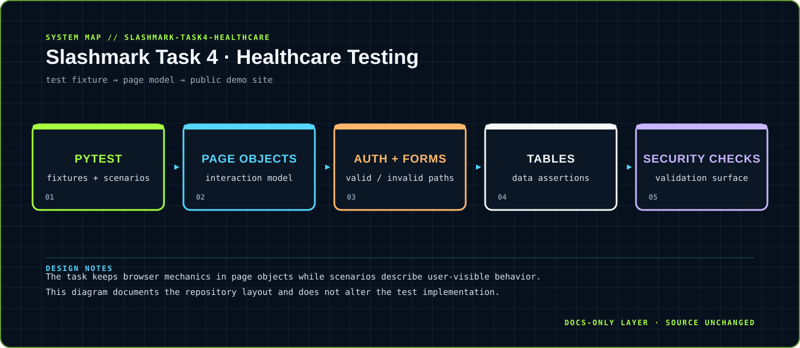

<div align="center">



</div>

# Slashmark Task 4 · Healthcare Testing

> Browser automation for authentication, forms, tables and security-oriented checks.

A Python + Selenium + pytest suite that models healthcare-style web interactions against public demo surfaces.

<div align="center">

`Python · Selenium · pytest` &nbsp;·&nbsp; `scenario → page object → form / table interaction → assertion`

</div>

## `01 / SYSTEM CARD`

- **Primary boundary:** `test fixture → page model → public demo site`
- **Documentation stance:** architecture and presentation only; application source is intentionally untouched.
- **Visual language:** Y2K terminal grid, brutalist labels, maximalist contrast, readable static SVG fallback.

## `02 / ARCHITECTURE`

The map above is a compact view of the repository's visible runtime boundary. It is designed to answer three questions quickly: where input enters, where policy or domain logic lives, and where external side effects leave the system.


## `03 / DESIGN NOTES`

- The task keeps browser mechanics in page objects while scenarios describe user-visible behavior.
- This diagram documents the repository layout and does not alter the test implementation.

This upgrade adds documentation assets only. It does not change source files, dependency manifests, tests, workflows or runtime configuration.

## `04 / EXISTING PROJECT DOCUMENTATION`

<details open>
<summary>Read the original project notes</summary>

# Task 4 — Healthcare Website Automation Testing

Automated test suite for healthcare-style web interactions using Python + Selenium + pytest. Covers authentication, form interactions, table data, and security validations against real, publicly available demo sites.

## What's Tested

- **Login & Authentication** — Valid/invalid login, flash messages, form validation
- **Form Interactions** — Dropdown selections, numeric inputs, form validation
- **Patient Records (Tables)** — Table display, row counts, data extraction, headers
- **Security & Privacy** — HTTPS validation, no exposed data, secure cookies

## Target Sites

- [The Internet - Login](https://the-internet.herokuapp.com/login) — Login form with tomsmith / SuperSecretPassword!
- [The Internet - Dropdown](https://the-internet.herokuapp.com/dropdown) — Dropdown selection tests
- [The Internet - Inputs](https://the-internet.herokuapp.com/inputs) — Numeric input tests
- [The Internet - Tables](https://the-internet.herokuapp.com/tables) — Table data display tests
- [Google](https://www.google.com) — HTTPS and security validation

## Setup

```bash
python3 -m venv venv
source venv/bin/activate
pip install -r requirements.txt
```

## Run Tests

```bash
# All tests
pytest

# By category
pytest -m smoke
pytest -m healthcare
pytest -m security

# Generate HTML report
pytest --html=reports/report.html --self-contained-html
```

## Tech Stack

- Python 3 + Selenium 4 + pytest
- Page Object Model design pattern
- WebDriver Manager for automatic browser driver management

## Intern

**M Vignesh Sai** — Slash Mark Internship (June 2026)

</details>

